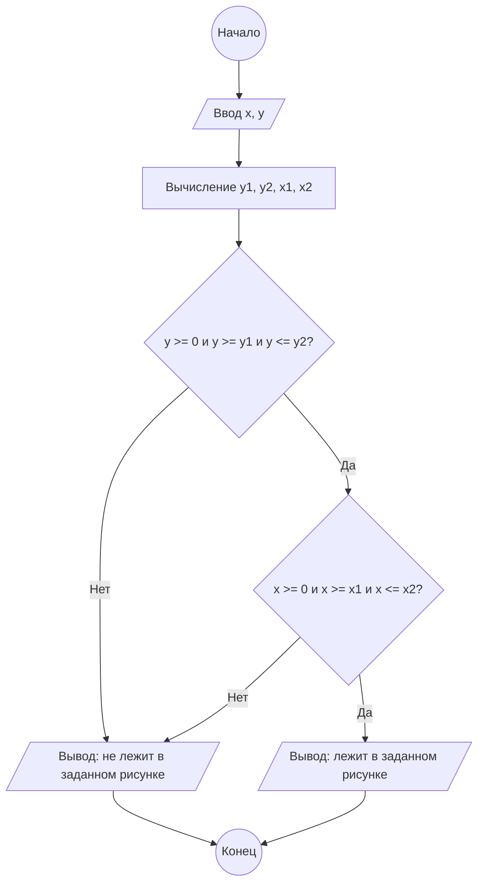

# Домашнее задание к работе №6

## 1. Алгоритм

1. Начало
2. Ввод данных: `x`, `y` — координаты точки (вводит пользователь).
3. Вычисление вспомогательных переменных (границ области):
   * `y1 = -2 * x - 6`
   * `y2 = -x + 6`
   * `x1 = (y - 4) / -2`
   * `x2 = 6 - y`
4. Проверка условия по оси Y: если `y >= 0` И `y >= y1` И `y <= y2`, то переходим к шагу 5. Иначе — к шагу 7.
5. Проверка условия по оси X: если `x >= 0` И `x >= x1` И `x <= x2`, то переходим к шагу 6. Иначе — к шагу 7.
6. Вывод сообщения: "Точка лежит в заданном рисунке".
7. Вывод сообщения: "Точка не лежит в заданном рисунке".
8. Конец.

## 2. Блок-схема



## 3. Реализация программы

```c
#include <stdio.h>
#include <locale.h>
#define _CRT_SECURE_NO_WARNINGS

void main() {
    setlocale(LC_ALL, "RUS");
    double x, y, x1, y1, y2, x2;
    
    puts("Введите абсциссу точки: ");
    scanf("%lf", &x);
    
    puts("Введите ординату точки: ");
    scanf("%lf", &y);
    
    y1 = -2 * x - 6;
    y2 = -x + 6;
    x1 = (y - 4) / -2;
    x2 = 6 - y;
    
    if (y >= 0 && y >= y1 && y <= y2) {
        if (x >= 0 && x >= x1 && x <= x2) {
            printf("Точка (%.1lf;%.1lf) лежит в заданном рисунке", x, y);
        } else {
            printf("Точка (%.1lf;%.1lf) не лежит в заданном рисунке", x, y);
        }
    } else {
        printf("Точка (%.1lf;%.1lf) не лежит в заданном рисунке", x, y);
    }
}
```

## 4. Результаты работы программы

**Пример 1. Точка внутри области**
```text
Введите абсциссу точки: 
3
Введите ординату точки: 
1
Точка (3.0;1.0) лежит в заданном рисунке
```

**Пример 2. Точка вне области (не проходит по X)**
```text
Введите абсциссу точки: 
1
Введите ординату точки: 
1
Точка (1.0;1.0) не лежит в заданном рисунке
```

**Пример 3. Точка вне области (отрицательная координата)**
```text
Введите абсциссу точки: 
-1
Введите ординату точки: 
2
Точка (-1.0;2.0) не лежит в заданном рисунке
```

## 5. Информация о разработчике

Кудрявцев Дмитрий, бИЦТ-261
